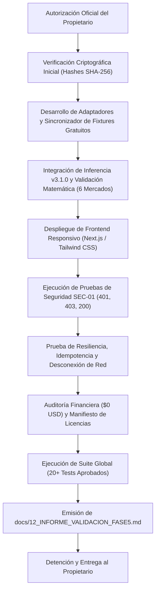

# SPORTPREDICT AI — PLAN TÉCNICO Y CRITERIOS DE ACEPTACIÓN MEDIBLES DE LA FASE 5

**Código de Documento:** `11_PLAN_TECNICO_FASE5.md`  
**Fecha de Definición:** 2026-11-09  
**Fase de Destino:** FASE 5 (Producto SaaS, Frontend Responsivo, Descubrimiento Automático e Integración Verificable de Mercados)  
**Versión Base del Motor:** `v3.1.0` (Validada científicamente en Fase 3.1 y blindada en Fase 4)  
**Estado:** **PLAN EN REVISIÓN — EJECUCIÓN NO AUTORIZADA NI INICIADA**  
**Restricción Mandataria:** Este documento define exclusivamente los requisitos técnicos obligatorios y criterios de aceptación medibles. **No constituye autorización para iniciar la Fase 5.** La ejecución requiere autorización expresa del propietario.

---

## 1. Contexto y Objetivos Técnicos de la Fase 5

Tras la validación del motor de predicciones `v3.1.0` (con validación temporal OOF y calibración en los 6 mercados evaluados) y el blindaje de seguridad SEC-01 alcanzado al cierre de la Fase 4, la **Fase 5** tiene como propósito estructurar la plataforma SPORTPREDICT AI como un producto SaaS funcional, robusto, observable y accesible para el usuario final.

Para considerar la Fase 5 terminada, **no basta con que la interfaz funcione superficialmente o que las pruebas unitarias pasen**: cada requisito debe contar con evidencia técnica cuantitativa, auditable y reproducible.

---

## 2. Criterios de Aceptación Medibles por Módulo

A continuación se establecen los 11 bloques de criterios de aceptación obligatorios que gobernarán la Fase 5:

```
+---------------------------------------------------------------------------------------------------+
|                         MATRIZ DE GOBERNANZA TÉCNICA — FASE 5                                     |
+---------------------------------------------------------------------------------------------------+
| 01. Integridad de Modelos y Datos     | 07. Seguridad de Endpoints (RBAC / SEC-01)               |
| 02. Descubrimiento y Sincronización   | 08. Interfaz y Experiencia de Usuario (Next.js UI)       |
| 03. Motor de Predicciones v3.1.0      | 09. Rendimiento, Estabilidad y Resiliencia               |
| 04. Cuotas y Valor Esperado (EV/CLV)  | 10. Presupuesto ($0 USD) y Licenciamiento Comercial       |
| 05. Registro Prospectivo Inmutable    | 11. Entrega Final Obligatoria (Informe de Validación 12)  |
| 06. Evaluación Estadística y Brier    |                                                           |
+---------------------------------------------------------------------------------------------------+
```

---

### CRITERIO 1: Integridad de Modelos y Datos Históricos

El sistema debe garantizar la preservación criptográfica absoluta de todo el trabajo científico anterior:

| ID | Requisito Técnico Específico | Umbral / Evidencia Exigida | Método de Verificación |
| :--- | :--- | :--- | :--- |
| **C1.1** | El modelo principal `v3.1.0` debe conservar exactamente su hash SHA-256 original. | `4d2c51db007f47c011b895c3c7e594907a58dc9b538e8ff992f6c00cf8837f47` (19.083.886 bytes). | Script SHA-256 automatizado pre y post ejecución. |
| **C1.2** | Los 7 modelos históricos (`v1.0.0` a `v3.1.0`) deben permanecer intactos en almacenamiento. | Cero modificaciones en `backend/artifacts/models/*.joblib`. Todos los hashes coinciden con los registros de Fase 4. | Verificación SHA-256 en suite de pruebas. |
| **C1.3** | El CSV histórico de 4.338 partidos reales CC0 debe conservar su hash original. | `66ebf7560f0284a422f1bc95807761d0c123aaf655ee3d8dc4a569e11d259751` (1.017.065 bytes). | Checksum SHA-256 sobre archivo en disco. |
| **C1.4** | Cero modificaciones retroactivas de campos pre-kickoff en predicciones prospectivas. | Inmutabilidad de los 13 campos pre-kickoff; prohibición total de `DELETE`. Solo se permiten actualizaciones posteriores autorizadas para liquidación (`settlement_status`, `actual_outcome_code`, `actual_outcome_binary`, `brier_contribution`, `log_loss_contribution` y `settled_at_utc`), preservando los sellos SHA-256 originales. | Pruebas de mutación SQL rechazadas por triggers SQLite y tests de liquidación controlada. |
| **C1.5** | Cero entrenamiento automático o sustitución no supervisada de modelos sin autorización. | Los artefactos `.joblib` en disco no son sobrescritos ni recompilados durante el runtime. | Inspección de fechas de modificación de archivo y permisos. |
| **C1.6** | El 100% de las predicciones entregadas por la API o visualizadas en la UI debe identificar explícitamente la versión del modelo. | `model_version = "v3.1.0"` presente en todas las respuestas JSON y componentes visuales. | Pruebas unitarias de esquema REST y contratos TypeScript. |

**Criterio de Aceptación Obligatorio:** Todos los hashes coinciden al 100%, con evidencia verificable en bitácora criptográfica reproducible.

---

### CRITERIO 2: Descubrimiento y Actualización Automática de Partidos

El sistema debe mantener actualizada la cartelera de encuentros programados de forma autónoma y legal:

| ID | Requisito Técnico Específico | Umbral / Evidencia Exigida | Método de Verificación |
| :--- | :--- | :--- | :--- |
| **C2.1** | Implementar al menos una fuente gratuita de fixtures con licencia compatible con SaaS comercial. | Licencia explícita CC0, Dominio Público o MIT verificada documentalmente antes de su ingesta (ej. OpenFootball fixtures / repositorios autorizados). | Verificación de metadata de licencia en el servicio de ingesta. |
| **C2.2** | Verificación estricta de licencia antes de habilitar la ingesta en base de datos. | Bloqueo automático (`ValueError("LICENCIA_NO_AUTORIZADA")`) si `commercial_saas_allowed == False`. | Test unitario con fuentes no comerciales (ej. football-data.co.uk bloqueado). |
| **C2.3** | Sincronización automática periódica al menos una vez cada 24 horas. | Tarea en segundo plano programada (APScheduler / Cron de backend) con registro en base de datos. | Simulación de ciclo cron y log de ejecución programada en `sync_logs`. |
| **C2.4** | Detección de nuevos partidos y actualización de fechas/horarios. | Actualización no destructiva de `kickoff_utc` y estados de partidos existentes sin perder claves foráneas. | Test de ingesta incremental con partidos modificados en fechas. |
| **C2.5** | Evitar duplicados mediante identificadores externos y reglas de reconciliación canónica. | Clave única compuesta (`competition_id`, `home_team_id`, `away_team_id`, `kickoff_utc`) y resolución por `team_aliases`. | Ingesta doble idéntica produce 0 inserciones duplicadas. |
| **C2.6** | Registro completo de trazabilidad de sincronización. | Cada ejecución registra fuente (`source_name`), fecha/hora UTC de consulta y timestamp de última sincronización. | Consulta SQL a la tabla `sync_logs` y exposición en endpoint. |
| **C2.7** | Resiliencia ante fallos de conectividad o indisponibilidad de la fuente externa. | En caso de timeout o error 5xx de la fuente, el sistema conserva los datos existentes y refleja `last_synced_at` previo. | Inyección de fallas HTTP simuladas sin afectación de datos locales. |
| **C2.8** | Prohibición absoluta de partidos inventados o alucinados ante fallos. | Si la fuente falla o está vacía, no se crean filas sintéticas en `matches`. | Verificación de integridad referencial y conteo estricto de partidos. |

> [!WARNING]
> Si durante la investigación técnica no se identifica una fuente gratuita que cumpla rigurosamente con los requisitos de licencia comercial para fixtures futuros, se documentará formalmente la limitación y se detendrá esa integración específica. **Bajo ninguna circunstancia se contratará un servicio de pago.**

**Criterio de Aceptación Obligatorio:** Importar correctamente un conjunto de fixtures de prueba, detectar actualizaciones de fecha, evitar duplicados y demostrar una sincronización automática reproducible mediante script de prueba.

---

### CRITERIO 3: Motor de Predicciones (`v3.1.0`)

El motor de inferencia debe garantizar rigor probabilístico, cobertura de mercados y ausencia total de información futura:

| ID | Requisito Técnico Específico | Umbral / Evidencia Exigida | Método de Verificación |
| :--- | :--- | :--- | :--- |
| **C3.1** | Utilizar exclusivamente el modelo validado `v3.1.0`. | Identificador del modelo `v3.1.0` en pipeline de inferencia (`is_active = True` en DB). | Verificación de IDs 31 a 35 en `ml_models`. |
| **C3.2** | Generación de probabilidades para 1X2 y los 5 mercados de goles evaluados en Fase 3.1. | Cobertura simultánea de: `1X2`, `OVER_1_5`, `OVER_2_5`, `UNDER_2_5`, `OVER_3_5` y `BTTS`. | Endpoint `/api/v1/matches/{id}/detailed-analysis` y `/market-comparison`. |
| **C3.3** | Límites matemáticos estrictos de probabilidad. | $\forall p \in \text{probabilidades}: 0.0 \le p \le 1.0$. | Aserción matemática automatizada sobre lote de predicciones. |
| **C3.4** | Coherencia de partición para 1X2. | $\sum (p_{\text{HOME}} + p_{\text{DRAW}} + p_{\text{AWAY}}) = 1.000000 \pm 10^{-6}$. | Validación de tolerancia numérica estricta. |
| **C3.5** | Validación de precondiciones mínimas de datos. | Si faltan variables indispensables (ej. menos de 3 partidos previos de un equipo o falta de parámetros Dixon-Coles), el sistema retorna `INSUFFICIENT_DATA` y no emite probabilidades infundadas. | Test con partido con equipos nuevos sin historial previo. |
| **C3.6** | Metadatos obligatorios en cada pronóstico. | Toda predicción incluye: `calculated_at_utc`, `match_id` y `model_version`. | Contrato Pydantic y serialización JSON. |
| **C3.7** | Estricta ausencia de fuga temporal (*Point-in-Time*). | Toda variable calculada debe corresponder a un instante estrictamente anterior al kickoff del partido (`t < kickoff_utc`). | Test automatizado verificando que ningún marcador post-kickoff interviene. |

**Criterio de Aceptación Obligatorio:** El 100% de las predicciones de prueba generadas cumplen las validaciones matemáticas y temporales sin excepciones.

---

### CRITERIO 4: Cuotas y Valor Esperado (EV / CLV)

La comparación matemática con el mercado debe regirse por la máxima honestidad estadística:

| ID | Requisito Técnico Específico | Umbral / Evidencia Exigida | Método de Verificación |
| :--- | :--- | :--- | :--- |
| **C4.1** | Cero invención o completitud sintética de cuotas. | Si no existe cuota real de un operador, el campo permanece en `None` / `null`. | Auditoría de base de datos sobre los 868 partidos históricos y prospectivos. |
| **C4.2** | Separación clara de probabilidades del modelo vs probabilidades implícitas del mercado. | La interfaz y la API muestran en columnas separadas: $p_{\text{modelo}}$ vs $q_{\text{fair}}$ (probabilidad implícita limpia de margen). | Inspección de JSON de respuesta y renderizado en UI. |
| **C4.3** | Cálculo de EV condicionado a cuotas reales válidas. | $\text{EV} = (p_{\text{modelo}} \times O) - 1.0$ se calcula **únicamente** cuando existe una cuota decimal $O > 1.0$. | Validación algorítmica: `calculate_expected_value`. |
| **C4.4** | Omisión explícita de EV ante cuotas faltantes. | Si no hay cuota observada, `expected_value = None` y la selección se etiqueta como `NO_ODDS_AVAILABLE`. | Test unitario con cuotas nulas. |
| **C4.5** | Metadatos de cuota requeridos. | Cada cuota capturada debe registrar: proveedor u operador (`bookmaker_name`), hora exacta de captura (`captured_at_utc`) y mercado específico. | Validación de campos en tabla `odds_snapshots`. |
| **C4.6** | Prohibición de presentar EV positivo como garantía de ganancia comercial. | Toda selección con EV > 0 se clasifica como `POSITIVE_EV_WITHIN_NOISE` o `CANDIDATE_STATISTICAL_EDGE`, acompañada de advertencia estadística visible. | Inspección de textos y componentes de advertencia en UI. |
| **C4.7** | Separación irrestricta entre datos reales y datos de demostración. | Cada cuota o partido de prueba debe portar `is_demo = True` y mostrar en pantalla el distintivo **`[DATOS DEMO]`**. | Verificación visual y pruebas de consulta filtradas. |

**Criterio de Aceptación Obligatorio:** Todos los cálculos matemáticos pasan pruebas independientes con casos analíticos conocidos; cero cuotas ficticias presentadas como reales.

---

### CRITERIO 5: Registro Prospectivo Inmutable y Liquidación Controlada

Para evitar el sesgo retrospectivo (*hindsight bias*), los pronósticos deben sellarse antes del evento, permitiendo únicamente actualizaciones posteriores estrictamente autorizadas para liquidación:

| ID | Requisito Técnico Específico | Umbral / Evidencia Exigida | Método de Verificación |
| :--- | :--- | :--- | :--- |
| **C5.1** | Registro estrictamente anterior al inicio del encuentro. | `predicted_at_utc < kickoff_utc`. Rechazo con HTTP 400 si se intenta registrar después del inicio. | Test de inserción con timestamp posterior al kickoff (rechazado). |
| **C5.2** | Inmutabilidad de campos originales pre-kickoff. | Los 13 campos pre-partido son inmutables: `match_id`, `kickoff_utc`, `model_version`, `model_code`, `market_code`, `selection_code`, `prob_model`, `fair_model_odds`, `observed_odds`, `implied_prob_fair`, `expected_value`, `predicted_at_utc`, `immutable_record_sha256`. | Disparo de `RAISE(ABORT)` en trigger SQLite ante intento de `UPDATE` sobre cualquiera de ellos. |
| **C5.3** | Prohibición absoluta de eliminación de registros. | Ningún registro prospectivo puede ser borrado de la base de datos bajo ninguna circunstancia (`DELETE` estrictamente bloqueado). | Disparo de `RAISE(ABORT)` en `trg_prospective_predictions_no_delete`. |
| **C5.4** | Actualizaciones posteriores autorizadas exclusivamente para liquidación. | Únicamente se permite modificar los 6 campos de liquidación post-partido: `settlement_status`, `actual_outcome_code`, `actual_outcome_binary`, `brier_contribution`, `log_loss_contribution` y `settled_at_utc`. | Validación en cláusula `WHEN` del trigger `trg_prospective_predictions_immutable_update`. |
| **C5.5** | Liquidación exclusivamente posterior a la finalización del encuentro. | Solo partidos con `status == "FINISHED"` y resultados oficiales son procesados en `/settle`. | Test de liquidación sobre partido `SCHEDULED` produce 0 liquidaciones. |
| **C5.6** | Idempotencia estricta en la liquidación. | Ejecutar la liquidación múltiples veces consecutivas produce `settled_records_count = 0` y no altera los registros liquidados ni sus sellos SHA-256. | Test de ejecución repetida en `test_phase4_settlement_idempotence`. |
| **C5.7** | Verificación criptográfica de firma SHA-256 pre-kickoff. | Cada fila del ledger verifica que su hash SHA-256 original (calculado sobre los 13 campos pre-partido) se mantiene idéntico antes y después de la liquidación. | Endpoint `/api/v1/phase4/prospective/ledger` reporta `all_hashes_valid: true`. |

> [!NOTE]
> **Coherencia con Triggers SQLite:** La inmutabilidad no prohíbe el `UPDATE` de forma ciega; implementa una lista blanca estricta coherente con `trg_prospective_predictions_immutable_update`. Cualquier intento de alterar datos pre-kickoff aborta la transacción, mientras que la liquidación post-partido opera legítimamente sobre los 6 campos autorizados.

**Criterio de Aceptación Obligatorio:** El 100% de los registros de prueba tienen integridad verificada; cero registros posteriores al kickoff, cero modificaciones a campos pre-kickoff, cero eliminaciones y cero liquidaciones duplicadas.

---

### CRITERIO 6: Evaluación Estadística Rigurosa y Potencia Muestral

La evaluación del sistema debe apegarse a los estándares de la ciencia de datos deportiva, diferenciando conceptualmente significancia de potencia y evitando conclusiones de rentabilidad apresuradas:

| ID | Requisito Técnico Específico | Umbral / Evidencia Exigida | Método de Verificación |
| :--- | :--- | :--- | :--- |
| **C6.1** | Métricas obligatorias de calibración y discriminación. | Brier Score, Log Loss y descomposición de calibración / refinamiento. | Verificación en `/api/v1/phase4/evaluation`. |
| **C6.2** | Conteo explícito de tamaño muestral evaluado. | Toda métrica reporta $N$ (partidos evaluados) y número de apuestas liquidadas. | Reporte cuantitativo en JSON y vistas estadísticas. |
| **C6.3** | Desglose por mercado y versión de modelo. | Métricas independientes para cada uno de los 6 mercados bajo `v3.1.0`. | Tabla de evaluación por mercado. |
| **C6.4** | Separación rigurosa entre resultados históricos y prospectivos. | Separación en dos bloques JSON disjuntos: `historical_test_evaluation_868_real_matches` y `prospective_evaluation_real`. | Auditoría de payload del endpoint de evaluación. |
| **C6.5** | Diferenciación formal de marcos muestrales teóricos. | Reconocimiento explícito de los umbrales bajo supuestos teóricos ($\bar{O}=2.00, e=0.03, \operatorname{Var}(R)=0.9991$):<br>• Significancia ($\alpha=0.05$): **3.004** (unilateral) vs **4.265** (bilateral).<br>• Potencia del 80%: **6.864** (unilateral) vs **8.714** (bilateral). | Documentación en interfaz y reportes sin presentar las cifras como garantías universales. |
| **C6.6** | Prohibición de afirmar rentabilidad por mero conteo muestral. | Alcanzar un umbral de $N$ registros es una condición necesaria de potencia, pero NO demuestra rentabilidad comercial por sí sola. Se exige validación de CLV medio positivo y Brier Score superior al mercado. | Verificación de textos y alertas en dashboard. |
| **C6.7** | Modelado de correlación intra-partido y sesgo de selección por EV. | Reconocimiento de que múltiples mercados de un mismo partido no son independientes ($N_{\text{eff}} < N_{\text{nominal}}$) y que filtrar por $\text{EV} \ge 2.0\%$ introduce sesgo muestral (Winner's Curse / regresión a la media). | Justificación del tamaño muestral con la varianza y dependencia observadas en los datos prospectivos. |
| **C6.8** | Prohibición de sobreajuste por selección repetida de modelos (*P-Hacking*). | No se realiza optimización de hiperparámetros ni selección de modelo sobre el conjunto de prueba retenido de 868 partidos. | Trazabilidad del script de entrenamiento de Fase 3.1. |

#### Tabla de Referencia Teórica de Tamaños Muestrales ($e=0.03, \bar{O}=2.00$)

| Objetivo Estadístico | Prueba Unilateral ($\alpha=0,05$) | Prueba Bilateral ($\alpha=0,05$) | Fundamento Estadístico |
| :--- | :---: | :---: | :--- |
| **Significancia ($\alpha=0,05$)** | **3.004 apuestas** | **4.265 apuestas** | Control del **Error Tipo I** ($\alpha$): probabilidad de afirmar erróneamente una ventaja cuando $H_0$ es cierta (azar). |
| **Potencia del 80% ($1-\beta=0,80$)** | **6.864 apuestas** | **8.714 apuestas** | Control del **Error Tipo II** ($\beta$): capacidad estadística de detectar una ventaja real del 3% si efectivamente existe. |

> [!WARNING]
> **Aclaraciones Críticas sobre la Potencia Muestral:**
> 1. **Diferencia Conceptual:** Significancia estadística ($\alpha$) y potencia estadística ($1-\beta$) son conceptos distintos. Una muestra de 3.004 apuestas permite rechazar el azar con $Z \ge 1.645$, pero solo una muestra de 6.864 apuestas otorga un 80% de probabilidad de capturar esa significancia si la ventaja real es del 3%.
> 2. **No son Garantías Universales:** Estas cifras derivan estrictamente de los supuestos teóricos asumidos ($\bar{O}=2.00, e=0.03, \operatorname{Var}(R)=0.9991$). Variaciones en las cuotas promedio o en el margen del operador alteran la varianza unitaria.
> 3. **Correlación Intra-Partido:** Múltiples mercados del mismo partido (ej. `1X2 HOME`, `OVER 2.5`, `BTTS`) comparten goles esperados comunes; **no equivalen a partidos independientes**. Tratar 13 selecciones de un partido como 13 grados de libertad independientes infla artificialmente la potencia aparente. El tamaño muestral efectivo ($N_{\text{eff}}$) depende del número de partidos distintos ($N_{\text{partidos}} \ge 3.000$).
> 4. **Sesgo de Selección por EV (Winner's Curse / Multiple Testing):** Seleccionar oportunidades con $\text{EV}_{\text{empírico}} \ge 2.0\%$ introduce sesgo condicional: se eligen los errores muestrales positivos más altos ($\hat{p} = p + \epsilon$), lo que produce regresión a la media en la muestra prospectiva.
> 5. **Justificación con Datos Reales:** El tamaño muestral definitivo debe justificarse con la varianza y la correlación empíricamente observadas en los datos prospectivos reales, nunca mediante afirmaciones apresuradas de rentabilidad basadas en conteos brutos.

**Criterio de Aceptación Obligatorio:** Métricas reproducibles a partir del libro prospectivo, justificación muestral basada en dependencia real observada y resultados auditables mediante script de validación independiente.

---

### CRITERIO 7: Seguridad de Endpoints y Control de Acceso (SEC-01)

El sistema debe operar bajo el modelo de privilegios mínimos:

| ID | Requisito Técnico Específico | Umbral / Evidencia Exigida | Método de Verificación |
| :--- | :--- | :--- | :--- |
| **C7.1** | Protección obligatoria del 100% de endpoints administrativos y de mutación sensible. | Endpoints `/odds/capture`, `/prospective/register/{match_id}`, `/prospective/settle` y rutas de reentrenamiento/ingesta requieren rol administrativo. | Pruebas de acceso con matriz de roles. |
| **C7.2** | Respuesta para solicitudes de usuarios no autenticados (anónimos). | **HTTP 401 UNAUTHORIZED** con encabezado `WWW-Authenticate: Bearer`. | Test con cliente HTTP sin credenciales ni encabezados de usuario. |
| **C7.3** | Respuesta para usuarios autenticados sin rol de administrador. | **HTTP 403 FORBIDDEN** con mensaje descriptivo de restricción. | Test con credenciales de usuario con rol `USER` o `ANALYST`. |
| **C7.4** | Acceso para administradores autorizados. | **HTTP 200 OK** con ejecución legítima de la operación. | Test con rol `ADMIN`. |
| **C7.5** | Validación exhaustiva de entradas y prevención de inyección. | Esquemas Pydantic estrictos con validación de tipos, rangos y desinfección de parámetros. | Pruebas de estrés y payloads anómalos. |
| **C7.6** | Cero exposición de secretos o credenciales. | Ninguna respuesta JSON, traza de error HTTP o log de servidor debe contener API keys, cadenas de conexión completas ni contraseñas. | Inspección de respuestas de error 4xx/5xx y logs de backend. |

**Criterio de Aceptación Obligatorio:** Todas las pruebas de seguridad automatizadas aprobadas al 100%, incluyendo pruebas negativas de rechazo para accesos no autorizados.

---

### CRITERIO 8: Interfaz de Usuario y Experiencia (UI/UX)

La aplicación web en Next.js (TypeScript / Tailwind CSS) debe ofrecer una experiencia visual transparente y profesional:

| ID | Requisito Técnico Específico | Umbral / Evidencia Exigida | Método de Verificación |
| :--- | :--- | :--- | :--- |
| **C8.1** | Diseño responsive en tres factores de forma. | Interfaz totalmente funcional y adaptada para móvil (375px), tablet (768px) y escritorio (1280px+). | Pruebas visuales documentadas en diferentes viewports. |
| **C8.2** | Visualización exclusiva de partidos verificados. | Solo se renderizan partidos válidos en base de datos; cero partidos artificiales o mockeados en cliente sin backend. | Comparación visual frente a respuestas del endpoint `/daily-matches`. |
| **C8.3** | Diferenciación visual clara de métricas. | Componentes visuales diferenciados por color y tipografía para: (1) Probabilidad del modelo, (2) Cuota de mercado, (3) EV porcentual. | Inspección de componentes en la vista de partidos. |
| **C8.4** | Identificación de mercados sin cuota. | Marcado claro y legible con etiqueta neutra `Sin Cuota` / `NO_ODDS_AVAILABLE` cuando una selección carece de cuota observada. | Test visual de partido con cuotas parciales. |
| **C8.5** | Visualización de la fecha de última sincronización. | Timestamp UTC visible en cabecera o pie de tabla indicando cuándo se actualizaron los partidos por última vez. | Componente `LastSyncBadge` en la interfaz. |
| **C8.6** | Visualización transparente del libro prospectivo. | Tabla accesible que liste las predicciones prospectivas con su estado (`PENDING`, `WON`, `LOST`), cuota observada, CLV y hash de sellado. | Vista del Ledger Prospectivo en `/prospective`. |
| **C8.7** | Distinción prominente de datos demostrativos. | Banner o tag de color amarillo/ámbar visible **`[DATOS DEMO]`** cuando se visualizan partidos o cuotas de prueba. | Inspección visual de la bandera `is_demo`. |
| **C8.8** | Identidad visual coherente y accesible. | Tema profesional en Azul Oscuro, cumplimiento de contrastes WCAG AA, sin saturación visual ni elementos de azar engañosos. | Auditoría de contraste y usabilidad. |

**Criterio de Aceptación Obligatorio:** Pruebas documentadas en los 3 factores de forma, cero errores críticos en consola de navegador y navegación sin fallos en rutas principales.

---

### CRITERIO 9: Rendimiento, Estabilidad y Resiliencia

El sistema debe operar de forma confiable sin degradar el entorno:

| ID | Requisito Técnico Específico | Umbral / Evidencia Exigida | Método de Verificación |
| :--- | :--- | :--- | :--- |
| **C9.1** | Cero errores críticos en la suite de pruebas. | 100% de las pruebas automatizadas ejecutadas con resultado exitoso. | `pytest backend/tests` con código de salida 0. |
| **C9.2** | Preservación del 100% de las pruebas preexistentes. | Las 20 pruebas de Fases 1 a 4 se mantienen aprobadas sin regresiones. | Ejecución continua del suite global. |
| **C9.3** | Nuevas pruebas automatizadas para cada funcionalidad agregada. | Cada conector, vista o endpoint nuevo debe incorporar pruebas unitarias y de integración dedicadas. | Verificación de cobertura incremental en `backend/tests/`. |
| **C9.4** | Invarianza de la base de datos persistente durante pruebas. | Las pruebas automatizadas utilizan exclusivamente la base de datos aislada temporal provista por `conftest.py`. `sportpredict_local.db` no sufre ninguna modificación durante `pytest`. | Comprobación de hash de `sportpredict_local.db` antes y después de pruebas. |
| **C9.5** | Tolerancia a fallos de servicios externos. | La caída de una fuente externa de datos no bloquea la API ni detiene el frontend; el sistema degrada con gracia mostrando datos en caché. | Prueba con mock de timeout de red en adaptadores externos. |

**Criterio de Aceptación Obligatorio:** Suite completa de pruebas aprobada al 100% y demostración de resiliencia ante fallos sin mutación de bases de datos persistentes.

---

### CRITERIO 10: Presupuesto y Licencias Comerciales

La plataforma debe desarrollarse bajo estricta disciplina financiera y de propiedad intelectual:

| ID | Requisito Técnico Específico | Umbral / Evidencia Exigida | Método de Verificación |
| :--- | :--- | :--- | :--- |
| **C10.1** | Presupuesto total autorizado. | **`0 USD` (Cero dólares estadounidenses).** | Estado de cuenta y registros de suscripción vacíos. |
| **C10.2** | Prohibición de contratación de APIs de pago. | No se adquieren planes de pago en The Odds API, API-Football u otros proveedores. | Verificación de configuración en `.env` (sin llaves comerciales pagas). |
| **C10.3** | Prohibición de contratación de infraestructura de pago. | No se activan instancias cloud de cobro recurrente durante esta fase. | Ejecución local o en capa gratuita verificada. |
| **C10.4** | Prohibición de períodos de prueba con conversión automática a cobro. | No se suscriben trials que requieran tarjeta de crédito con riesgo de facturación. | Declaración jurada de no suscripción en informe final. |
| **C10.5** | Auditoría de licencias de software y datos. | Todo componente, librería o dataset incorporado debe contar con licencia compatible (MIT, Apache 2.0, CC0 o Dominio Público). | Manifiesto de licencias de dependencias en `backend/` y `frontend/`. |

**Criterio de Aceptación Obligatorio:** Evidencia auditable de cero gastos económicos devengados, cero pasarelas activadas y catálogo de licencias 100% compatible con uso comercial SaaS.

---

### CRITERIO 11: Entrega Final Obligatoria (`docs/12_INFORME_VALIDACION_FASE5.md`)

Para dar por concluida la Fase 5, se deberá generar obligatoriamente el informe de cierre [`docs/12_INFORME_VALIDACION_FASE5.md`](file:///f:/Proyectos/Predicciones/docs/12_INFORME_VALIDACION_FASE5.md) (con copia en la raíz [`12_INFORME_VALIDACION_FASE5.md`](file:///f:/Proyectos/Predicciones/12_INFORME_VALIDACION_FASE5.md)), estructurado de acuerdo con la siguiente matriz:

```markdown
| ID Criterio | Requisito Obligatorio | Resultado Observado | Evidencia / Archivo / Prueba | Estado Final |
| :---: | :--- | :--- | :--- | :---: |
| C1.1 | Hash SHA-256 de v3.1.0 idéntico | Hash verificado 4d2c... | backend/artifacts/models/sportpredict_models_v3.1.0.joblib | APROBADO |
| ... | ... | ... | ... | ... |
```

Estados admisibles por criterio:
- **`APROBADO`**: Cumplimiento verificado con evidencia reproducible adjunta.
- **`RECHAZADO`**: Incumplimiento del requisito técnico o desviación en los umbrales.
- **`PENDIENTE`**: Requisito no ejecutado o pendiente de verificación.

> [!CAUTION]
> **REGLA DE CIERRE ESTRICTA:**  
> Bajo ninguna circunstancia se declarará terminada la Fase 5 si existe al menos un criterio obligatorio en estado **`RECHAZADO`** o **`PENDIENTE`**.

---

## 3. Matriz de Coherencia Cruzada de Criterios (C1 a C11)

Para garantizar que el plan técnico no contenga contradicciones internas ni ambigüedades operativas, se verificó formalmente la coherencia entre todos los criterios:

| Eje de Coherencia | Criterios Involucrados | Análisis de Compatibilidad y Resolución de Conflictos | Estado |
| :--- | :---: | :--- | :---: |
| **1. Liquidación vs Inmutabilidad** | **`C1.4`, `C5.2`, `C5.3`, `C5.4`** | **Sin conflicto:** Los 13 campos pre-kickoff y el hash SHA-256 son inmutables; `DELETE` está prohibido. Solo se permite actualizar los 6 campos específicos de liquidación post-partido (`settlement_status`, `actual_outcome_code`, `actual_outcome_binary`, `brier_contribution`, `log_loss_contribution` y `settled_at_utc`), regla reflejada de forma idéntica en los triggers SQLite. | **COHERENTE** |
| **2. Seguridad vs Roles Existentes** | **`C7.1` - `C7.4`** | **Sin conflicto:** La política de control de acceso reutiliza el modelo RBAC existente en [`backend/app/core/security.py`](file:///f:/Proyectos/Predicciones/backend/app/core/security.py): anónimo $\rightarrow$ HTTP 401 (`WWW-Authenticate: Bearer`), autenticado no admin (`USER`, `ANALYST`) $\rightarrow$ HTTP 403, y administrador (`ADMIN`) $\rightarrow$ HTTP 200. | **COHERENTE** |
| **3. Automatización Gratuita vs Presupuesto ($0 USD)** | **`C2.1`, `C2.3`, `C10.1`, `C10.2`** | **Sin conflicto:** La sincronización automática diaria de partidos utiliza exclusivamente fuentes gratuitas con licencia abierta compatible. Si no existe una fuente gratuita viable, se detiene la integración y se documenta la limitación, preservando el presupuesto de $0 USD sin contratar APIs ni servicios de pago. | **COHERENTE** |
| **4. Licenciamiento Comercial Verificable** | **`C2.1`, `C2.2`, `C10.5`** | **Sin conflicto:** La verificación de licencia comercial es un paso previo bloqueante en el pipeline de ingesta (`commercial_saas_allowed == True`). Fuentes incompatibles con SaaS comercial (ej. licencias no comerciales NC o de uso privado) son rechazadas por código con excepción explícita. | **COHERENTE** |
| **5. Separación Estricta Demo vs Real** | **`C4.7`, `C6.4`, `C8.7`** | **Sin conflicto:** La bandera `is_demo` gobierna el aislamiento en los 3 niveles del sistema: base de datos (filtro booleano), API (bloques JSON disjuntos) y UI (distintivo ámbar `[DATOS DEMO]`), garantizando que ningún dato de prueba se mezcle con el libro prospectivo real. | **COHERENTE** |

---

## 4. Plan de Verificación y Evidencias Reproducibles

Cuando el propietario autorice el inicio de la Fase 5, cada uno de los bloques anteriores se validará mediante la siguiente secuencia de scripts y pruebas automatizadas:



---

## 5. Declaración de Estado y Bloqueo de Fase 5

> [!IMPORTANT]
> **ESTADO FORMAL DEL SISTEMA:**
> - El presente plan técnico define los requerimientos de aceptación obligatorios acordados para la Fase 5.
> - **LA FASE 5 NO SE ENCUENTRA EN EJECUCIÓN.**
> - El sistema permanece en reposo a la espera de la autorización expresa del propietario para dar inicio a las tareas de implementación.
