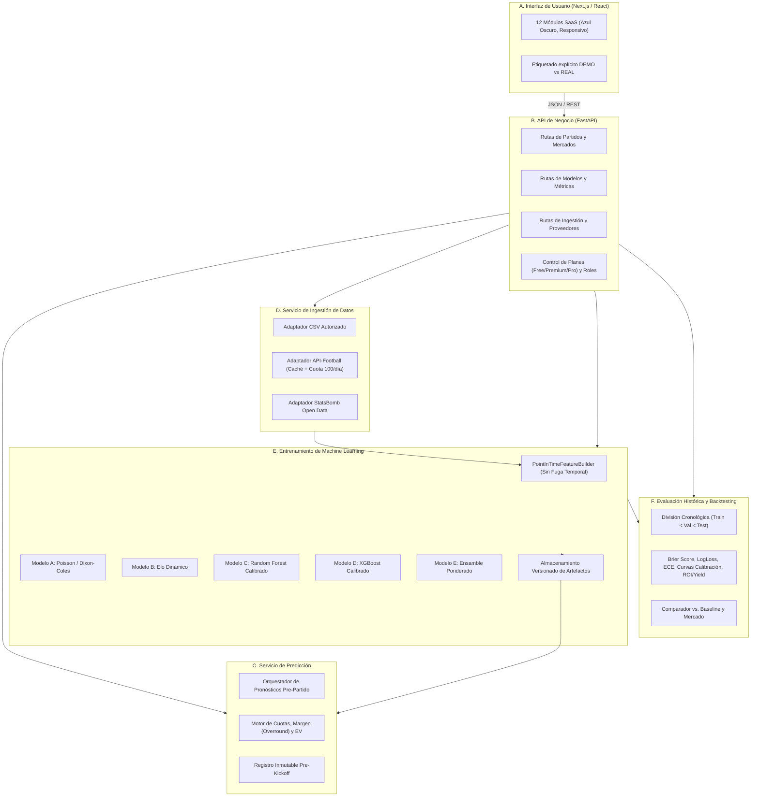

# SPORTPREDICT AI — Decisiones Arquitectónicas (ADR)

## 1. Separación Estricta en 6 Capas (A - F)

Para garantizar mantenibilidad, auditabilidad estadística y escalabilidad como producto SaaS, el sistema se divide en seis subsistemas desacoplados:

---

## 2. Registro de Decisiones de Arquitectura (ADR)

### ADR-001: Prohibición de lógica predictiva en el Frontend
- **Contexto:** Muchas aplicaciones prototipo calculan probabilidades o fórmulas de EV en componentes de React, lo que impide auditar versiones de modelos y expone lógica propietaria.
- **Decisión:** El frontend en Next.js actúa exclusivamente como capa de presentación analítica. Toda inferencia, calibración, remoción de margen de casa de apuestas y cálculo de Valor Esperado ($EV$) ocurre en el backend Python y queda registrado con `model_version` y marca de tiempo.

### ADR-002: Construcción de Variables *Point-in-Time* (Cero Fuga de Información)
- **Contexto:** El error más frecuente en modelos deportivos es calcular promedios de temporada o calificaciones usando datos posteriores a la fecha del partido evaluado (*data leakage*).
- **Decisión:** El módulo `PointInTimeFeatureBuilder` construye el vector de cada encuentro filtrando exclusivamente registros con `match_date < current_match_date`. Las calificaciones Elo se actualizan únicamente después de liquidar cada encuentro en orden cronológico estricto.

### ADR-003: No asumir superioridad de modelos complejos sobre modelos paramétricos
- **Contexto:** En fútbol, debido a la baja cantidad de goles por partido y la alta varianza, un modelo de Poisson bien parametrizado o un sistema Elo suele superar en calibración (Brier Score / Log Loss) a árboles de decisión sobreajustados cuando el tamaño de muestra es moderado.
- **Decisión:** El **Modelo E (Ensamble)** no asigna pesos fijos ni prioriza XGBoost por defecto. Calcula los pesos en el conjunto de validación temporal mediante el inverso del Log Loss / Brier Score y descarta automáticamente cualquier modelo cuyo desempeño sea inferior al modelo de referencia o degrade el conjunto.

### ADR-004: Base de Datos Dual (Supabase PostgreSQL en Producción / SQLite Aislado en Desarrollo Local)
- **Contexto:** Se requiere compatibilidad nativa con PostgreSQL mediante un proyecto Supabase independiente sin modificar bases de datos existentes ni exigir credenciales ficticias para ejecutar las pruebas locales de la Fase 1.
- **Decisión:** Se provee el esquema SQL completo para Supabase (`database/schema.sql`) con políticas RLS y tipos nativos de PostgreSQL, mientras que la capa ORM (SQLAlchemy 2.0) lee `DATABASE_URL` desde `.env`. Si no se define una URL remota de Supabase, opera sobre una base relacional local (`backend/data/sportpredict_local.db`) manteniendo exactamente las mismas tablas e integridad referencial.

### ADR-005: Gobernanza de Proveedores de Datos y Control de Cuota (API-Football)
- **Contexto:** El plan gratuito de API-Football permite 100 solicitudes diarias y fuentes como Football-Data no permiten entrenamiento comercial ni scraping sin autorización.
- **Decisión:**
  1. Se prohíbe cualquier scraper no autorizado.
  2. Cada proveedor implementa la interfaz `DataProviderAdapter` con registro de licencia (`source_license`), contador diario en base de datos (`requests_today / daily_quota_limit`) y caché local por endpoint y parámetros.
  3. Cuando la cuota diaria llega a su umbral de seguridad (ej. 95/100), el adaptador sirve exclusivamente desde caché y bloquea nuevas peticiones externas hasta el siguiente ciclo UTC.
